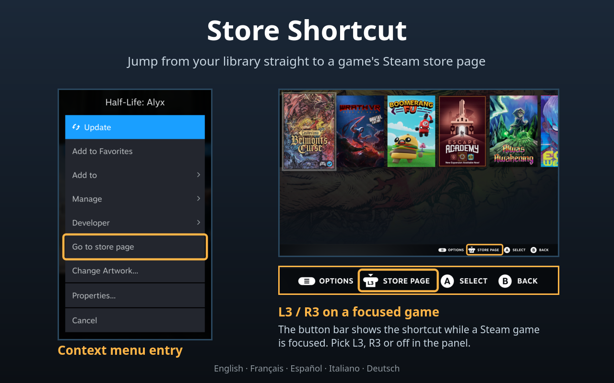

# Store Shortcut



Decky Loader plugin for Steam Game Mode: opens a library game's store page without
entering its game page first, from the capsule's context menu or with a button press.

Status: **v1.1.2.** Both features work in Game Mode.
Languages: English, French, Spanish, Italian and German (follows Steam by default).

- **Context menu entry:** "Go to store page" in the menu of a library capsule. Shown only
  for Steam games (hidden for non-Steam shortcuts and when several games are selected).
- **Shortcut button:** with a Steam game's capsule focused (Home or any Library tab), press
  **L3** to open its store page. The button bar shows the L3 glyph with "Store page" while
  such a capsule is focused. The button can be switched to **R3** or turned off, and the
  hint can be hidden. On a non-Steam shortcut the button shows a short notice instead
  (can be turned off). Steam leaves L3 and R3 unused in the library, so no native function
  is taken over.

Everything can be turned on or off in the plugin's panel, which also shows whether each
part is active or why it is unavailable.

Store pages open in Steam's own web view; **B** returns to where you were.
The plugin makes no network requests of its own.

Device checks and known issues: `docs/device-checklist.md`.

## Install

The plugin is not in the Decky store; install it from a GitHub release:

1. Download `Store-Shortcut-vX.Y.Z.zip` from the
   [latest release](https://github.com/TassaDarK-MGJ/decky-store-shortcut/releases/latest).
2. In Decky's settings, turn on **Developer mode** (General).
3. Developer → **Install Plugin from ZIP File** → choose the zip.

To update, install the newer zip the same way.

## Development

Requirements: Decky Loader ≥ 3.0 with developer mode, Node 24 (`brew install node@24`),
pnpm 9 (`corepack enable`).

```sh
export PATH=/home/linuxbrew/.linuxbrew/opt/node@24/bin:$PATH
pnpm install
pnpm run build          # runs lint:legacy first
pnpm run deploy         # build + copy to ~/homebrew/plugins/Store-Shortcut + restart Decky
pnpm run cdp targets    # dev helper for the Steam CEF debugger (see scripts/cdp.mjs)
```

Spikes and probes: see `docs/SPIKES-RUNBOOK.md` and `docs/PHASE0-FINDINGS.md`.

## License

0BSD for this project's own code. Files derived from decky-plugin-template keep
its BSD-3-Clause notice (both in `LICENSE`). The built bundle includes
`@decky/api`, which is LGPL-2.1.
